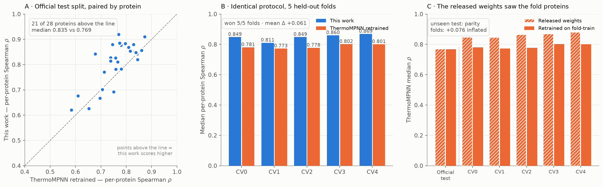

# ESM-2 + ProteinMPNN fusion for protein stability (ΔΔG)

Predicting how a single amino-acid mutation changes protein stability, on the Tsuboyama et al.
mega-scale dataset using ThermoMPNN's own protein splits. **Metric: median per-protein Spearman ρ.**



## Results

| Evaluation | This work | ThermoMPNN | Δ (95% CI) | Won | p |
|---|---|---|---|---|---|
| **5 CV folds, identical protocol** | **0.848** | 0.787 (retrained) | **+0.061** | **259/298 proteins, 5/5 folds** | 4.6e-4 … 6.5e-11 |
| Official test split | **0.835** | 0.769 (retrained) | +0.066 [0.036, 0.090] | 21/28 | 2.7e-4 |
| Official test split | **0.835** | 0.772 (released weights) | +0.063 [0.029, 0.085] | 21/28 | 5.8e-4 |
| **S669 (external benchmark)** | **0.596** | 0.514 (retrained) | **+0.082** [0.029, 0.138] | 588 variants / 84 chains | — |

Won every cross-validation fold, each with a bootstrap CI excluding zero, and the margin holds on a
benchmark from entirely different proteins and labs.

<details>
<summary>Per-fold detail</summary>

| Fold | This work | ThermoMPNN retrained | Δ | 95% CI | Won | p |
|---|---|---|---|---|---|---|
| CV0 | 0.849 | 0.781 | +0.068 | [0.040, 0.084] | 44/51 | 1.0e-6 |
| CV1 | 0.811 | 0.773 | +0.038 | [0.022, 0.055] | 46/59 | 4.6e-4 |
| CV2 | 0.849 | 0.778 | +0.071 | [0.051, 0.092] | 55/63 | 2.2e-9 |
| CV3 | 0.860 | 0.802 | +0.059 | [0.045, 0.088] | 56/63 | 3.8e-9 |
| CV4 | 0.869 | 0.801 | +0.068 | [0.051, 0.083] | 58/62 | 6.5e-11 |

</details>

## The methodological finding

**ThermoMPNN's released weights cannot legitimately be scored on its own CV folds.** Those weights
trained on the mega-split train proteins; the folds repartition all 298, so most fold-*test*
proteins sit inside its *training* set:

| ThermoMPNN, released weights | Median ρ |
|---|---|
| Official test split (genuinely unseen) | 0.772 |
| CV folds (largely seen in training) | 0.847 – 0.881 |

That **+0.076 inflation is memorisation, not skill**, and it reverses the apparent conclusion:
scored against released weights this model "loses" all 5 folds; scored against the same
architecture retrained on each fold's own training proteins, it wins all 5.

**The retrained baseline is faithful, not a straw man.** On the official split it reaches ρ = 0.773
versus the released weights' 0.772 — reproducing the published-level result to within 0.001.
`fusion/code/thermo_train.py` re-implements their `TransferModel` with their own `config.yaml`.

## Method

**Sequence stream** — ESM-2 (650M/3B/15B), LoRA on q/k/v/dense, a softmax-weighted mix of *all*
hidden layers, plus a learned α·(masked-LM log-likelihood ratio) term.

**Structure stream** — the official ProteinMPNN `v_48_020` checkpoint under a full strict
`state_dict` load, consumed exactly as ThermoMPNN consumes it. This replaced a re-implemented
encoder in the earlier phase that only partially matched the public checkpoint, leaving most of its
"pretrained" weights silently random. Fixing that was worth more than any hyperparameter.

**Fusion** — a 2-layer transformer over both streams; a per-residue 20-way head; ΔΔG =
`head[mut] − head[wt]`. Loss = MSE + (1 − per-protein Pearson) + a pairwise ranking term, since the
metric is rank-based.

**Data** — Tsuboyama ΔΔG: 239 train / 31 val / 28 test proteins (271,231 variants across all 298),
split at the protein level. Plus ThermoMPNN's 5 CV folds.

**Protocol** — selection on validation data only; the ensembling strategy chosen on the CV folds and
locked before test. `fusion/PREREGISTRATION.md` and `PREREGISTRATION_R3.md` were each written
before the corresponding models were trained.

## Ablations

Validation ρ, 3 seeds each (`fusion/results/round2_runs.csv`):

| Variant | Mean val ρ | |
|---|---|---|
| ProteinMPNN only | 0.797 | structure alone |
| ESM-2 650M only | 0.848 | sequence alone |
| Fusion 650M | 0.857 | **both streams beat either** |
| Fusion 3B | 0.868 | |
| Fusion 3B + ranking loss | **0.871** | best single config |
| Fusion 15B | 0.864 | no gain over 3B |
| + cross-attention | 0.858 | rejected |
| + auxiliary burial task | 0.863 | rejected |

## Transfer test: S669

Does this work off the dataset it trained on? Tested on **S669** — 669 variants, 94 chains, none of
it trained on. Training uses mega `train_s669` (every S669 homologue removed, verified against
ThermoMPNN's own mmseqs map, and none of the removed proteins is in the selection set), and
ThermoMPNN is retrained on those same 232 proteins. Scored pooled over variants as the literature
does, since S669 averages ~3 variants per chain.

**0.530 pooled Spearman over all 667 converted variants** (CI [0.466, 0.588]), and **0.596 against
the baseline's 0.514** on the 588 variants both models place (+0.082, CI [0.029, 0.138]; 99.8% of
paired bootstraps favour it).

*Caveat, stated rather than buried:* my score is 0.530 on all 667 but 0.596 on the intersection,
while the baseline's is 0.514 either way — the variants its parser drops are ones this model
predicts badly (ρ = −0.07 on those 79). Chain length explains why:

| Chain length | variants | This work | ThermoMPNN retrained | Δ |
|---|---|---|---|---|
| ≤ 72 (the training range) | 129 | **0.799** | 0.686 | +0.113 |
| 73 – 120 | 229 | **0.666** | 0.585 | +0.080 |
| 121 – 200 | 148 | **0.689** | 0.522 | +0.167 |
| **201 +** | 82 | 0.114 | 0.138 | −0.024 |

Nothing in training exceeds 72 residues. The model generalises to roughly 3× that, then **both
models collapse above ~200 residues** — a consequence of the training distribution rather than of
this architecture, and the clearest limitation of anything trained on this dataset.

## Negative results

Reported because the pre-registrations committed to reporting them.

**Round 3 failed entirely.** Round 2's logs showed validation peaking at a mean epoch of 8.4
(max 22) against a 40-epoch cap — every run overfit early — so with 215k variants but only 239
proteins, the model is **protein-limited, not capacity- or compute-limited**. Four ideas were tested
on that diagnosis and **none beat the baseline** (650M, 3 folds × 2 seeds, paired):

| Arm | Δ val | Δ fold test | test wins |
|---|---|---|---|
| + FireProtDB, 88 proteins (239 → 327) | −0.0082 | −0.0111 | **0/6** |
| + FireProtDB, down-weighted | −0.0061 | −0.0138 | **0/6** |
| + LoRA & head dropout | −0.0020 | −0.0068 | 1/6 |
| + soft-rank Spearman surrogate | +0.0003 | −0.0033 | 1/6 |

FireProt was the arm with real expected upside and it made things *worse*, consistently. That is a
data property, not a bug: its labels use the opposite sign convention (positive = destabilizing,
corroborated by corr(ddG, ASA) = −0.34) and a wider spread, both corrected so the converted
distribution matches Tsuboyama to three decimals; only the `homologue-free` split is used, so
nothing is homologous to any megascale protein; and down-weighting did not rescue it.
**Cross-assay stability data does not transfer here** — its label noise outweighs the structural
diversity it adds.

**Two ideas were dropped before testing**, with reasons recorded rather than quietly forgotten:
*train longer* (refuted by the best-epoch distribution above) and *reverse-mutation augmentation*
(a no-op — ΔΔG is read off one wild-type pass, so antisymmetry already holds exactly).

**Retraining on train+val does not help** — mean Δ −0.0007 across folds despite +13% more data, so
the final model does not use it. **Ensembling strategy barely matters** — single-best, top-k and
greedy all land within 0.0025, far inside the 0.022 fold-to-fold spread.

## Disclosure

The official test split was scored **exactly twice in total**, once per phase (0.842, then 0.835);
the 0.007 difference sits well inside the ±0.03 CI at n = 28. Round 3 deliberately did **not** score
it a third time, so the locked guarantee stands. Both numbers are reported; neither was selected by
looking at test.

The project's earlier phase used a re-implemented structure encoder and reached test ρ = 0.7547
against ThermoMPNN's 0.7720 — no clear difference either way (p = 0.465). Most of the gap to 0.835
comes from the structure encoder actually loading its pretrained weights, plus the ranking loss
(+0.004) and a 3B backbone (+0.011).

## Limitations

- **Do not trust this model above ~200 residues** — both it and the baseline collapse there, and
  nothing in training exceeds 72.
- The official test split has only 28 proteins; the 5-fold result across 298 is the stronger
  evidence, and the two agree (+0.066 and +0.061).
- Strong rank correlation does not mean individual ΔΔG values are numerically accurate. The S669
  RMSE is not quoted as an error figure, because predictions are calibrated to Tsuboyama's label
  scale (std 1.00) while S669's spread is std 1.64.
- Generalisation is measured, but on a single external benchmark; membrane proteins are untested.
- This approach looks close to its ceiling: round 3's four ideas all failed, and Tsuboyama's own
  replicate reproducibility bounds per-protein ρ near 0.88–0.90.
- Predictions are for research prioritisation, not a substitute for experiment.

## Repository

```
fusion/
  README.md  PREREGISTRATION.md  PREREGISTRATION_R3.md
  code/
    stab2.py            the fusion model
    stab3.py            round 3 + the S669 split
    thermo_train.py     retrains ThermoMPNN's TransferModel = the fair baseline
    ens2/ens3/final.py  ensembling, strategy selection, locked evaluation
    fireprot_build.py   FireProtDB -> training tensors
    s669_build.py  s669_thermo.py  s669_eval.py  s669_compare.py
    gen_thermo_all.py  launch2.py  run_thermo.sh  runq.py  ab.py  figure.py
  results/
    final_results.json  final_cv_fair.csv       headline numbers, per fold
    s669_summary.json   s669_by_length.csv      the transfer result
    round3_runs.csv     round3_ab.json          the negative result
    round2_runs.csv     thermompnn_retrained_runs.csv
    runs2/  runs_thermo/  runs_thermo_s669/     per-run records
    results.png
```

Earlier-phase pipeline: `train_esm2_spurs_fixed.py`, `run_structure_track.py`, `analyze_650_local.py`.

## Reproduce

```bash
git clone https://github.com/dauparas/ProteinMPNN    ext/ProteinMPNN
git clone https://github.com/Kuhlman-Lab/ThermoMPNN  ext/ThermoMPNN

# headline result
python fusion/code/launch2.py 2          # the sweep from results/queue2.txt
bash   fusion/code/run_thermo.sh         # retrain the baseline, 5 seeds x 6 splits
python fusion/code/ens3.py               # choose the ensembling strategy on the folds
python fusion/code/ens3.py --lock        # lock it before touching test
python fusion/code/final.py              # fair comparison + the single locked test eval

# round 3 (negative) and the S669 transfer test
python fusion/code/fireprot_build.py && python fusion/code/runq.py queue_screen.txt 2
python fusion/code/ab.py S0_base S1_fp S2_fp03 S3_reg S4_sr
python fusion/code/s669_build.py && python fusion/code/s669_thermo.py --seed 0
python fusion/code/s669_compare.py T_3B
```

Runtimes on one RTX PRO 6000 (96 GB): 650M ≈ 2 min, 3B ≈ 3 min, 15B ≈ 6 min, ThermoMPNN baseline
≈ 10 s after feature caching. **218 training runs** in total: 58 (earlier phase) + 91 (headline) +
30 (retrained baseline) + 30 (round 3) + 9 (S669 transfer).
